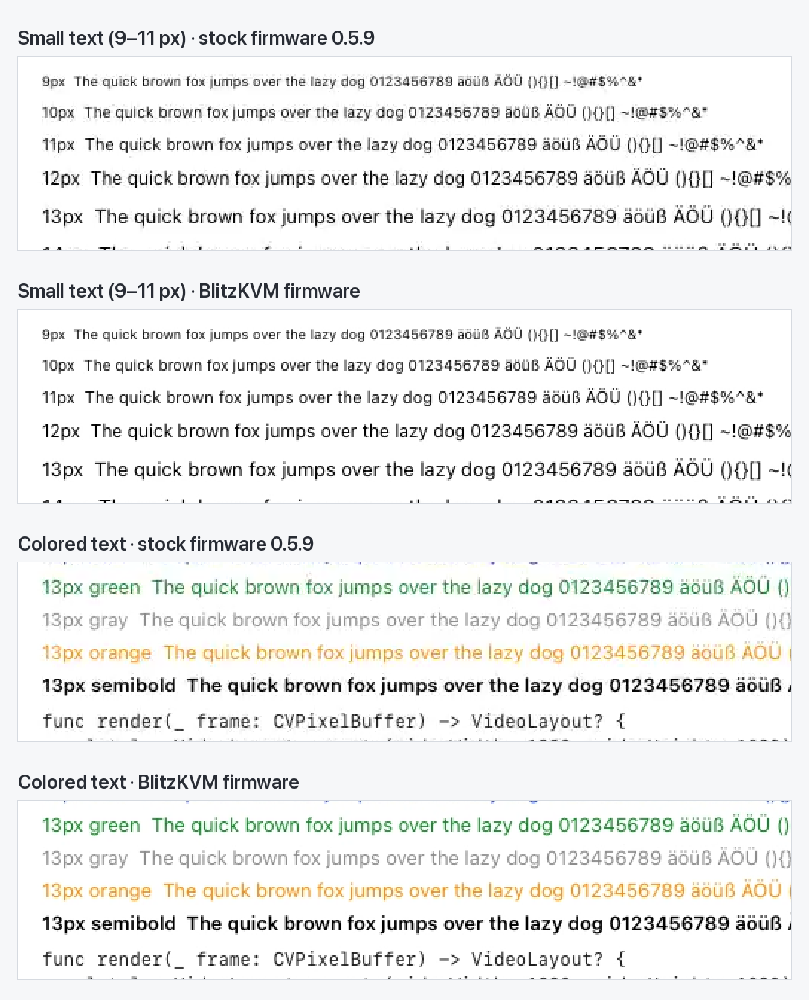

# Benchmarks

What BlitzKVM and its firmware measure on real hardware: input latency, picture quality, bandwidth, slow links and audio. Every number below was measured, mostly on the setup described first, and every method is in the repository so it can be repeated. The engineering log behind them is [`plans/2026-10-10-engineering-plan.md`](plans/2026-10-10-engineering-plan.md) (§21–§31).

**Contents:** [Setup](#setup) · [At a glance](#at-a-glance) · [Input latency](#input-latency) · [Picture quality](#picture-quality) · [Bandwidth and frame rate](#bandwidth-and-frame-rate) · [Slow links](#slow-links) · [Audio](#audio) · [Long sessions](#long-sessions) · [Method](#method) · [Reproduce](#reproduce)

## Setup

| | |
|---|---|
| Device | JetKVM v2 (Rockchip RV1106, Toshiba TC358749 HDMI bridge) on firmware 0.5.9: JetKVM's own build ("stock") or the BlitzKVM build ([wottpal/kvm](https://github.com/wottpal/kvm), `release/0.5.9-fork.5`/`fork.6`) |
| Target | Mac mini over HDMI, Safari showing the test pages |
| Client | Mac with an M4 Max, 60 Hz displays; a 40" 5K2K display (3008×1269 points) for round 3 |
| Network | Wired LAN (~1 ms RTT); slow links through the engine's link model (`BLITZKVM_IMPAIR`) |

"Before" means stock firmware 0.5.9 with the first version of the native client, unless a row says otherwise. Medians of 30–40 samples.

## At a glance

| Area | Measure | Before | Now |
|---|---|---|---|
| Latency | Key press to screen, 2400×1012@60, full screen / window | 91.2 / 96.0 ms | **77.5 / 78.8 ms** |
| Latency | Pointer move to screen, full screen / window | 57.4 / 65.0 ms | **53.0 / 57.7 ms** |
| Latency | Key press to screen, 1280×720@120 | — | **47.0 ms** |
| Text | Light text, PSNR against the exact test image (still) | 32.6 dB | **60.5 dB** |
| Color | Colored text, RGB PSNR as displayed | 28.1 dB | **51.4 dB** |
| Retina | Text enlarged 2.5×, against FSR 1 | FSR 1 | **+1.3 to +3.0 dB** |
| Bandwidth | A still screen | 1.4 Mbit/s | **0.07 Mbit/s** |
| Motion | Scrolling 1080 px/s | 42.4 dB (QP floor 24; stock can't be scored while scrolling) | **48.5 dB at 60 fps** |
| Slow links | Hotel Wi-Fi profile: dropped frames / keyframe requests per minute | 283 / 12 | **20 / 0** |
| Slow links | Key → decoded over Tailscale with Tailscale on the JetKVM, scrolling now and then (median / p90) | 107.8 / 194 ms | **98.0 / 124 ms** |
| Slow links | Away from home, a JetKVM running Tailscale: quality level and key → screen with scroll bursts (median) | low or minimal, 101.5 ms (via Tailscale) | **high or maximum, 92.5 ms** (direct) |
| Input | Input stuck after a 3 s network hiccup | +3.5 s, up to 60 s | **≤ 0.7 s** |
| Audio | Device CPU and traffic while the target is silent | — | **0.1 %, no packets** |

PSNR is in dB against the exact test image: higher is better, 40 dB is visibly soft text, 50 dB and more is hard to tell from the original.



*Decoded frames of the test pattern, enlarged 2×: stock firmware 0.5.9 against the BlitzKVM firmware's encoder settings (QP floor 10). The still refresh adds another 7 dB on top once the screen stops changing.*

## Input latency

The latency probe presses a key on the target (or moves the pointer), finds the first decoded frame that shows the change and takes the moment that frame reached the local screen (`MTLDrawable.presentedTime`). The target's own input-to-HDMI time is part of every sample, as it is for you: about 45 ms for a key in Safari and 18 ms for the pointer on the Mac mini.

### At 2400×1012, 60 Hz (round 3)

| | Before | Now |
|---|---|---|
| Key → screen, full screen | 91.2 ms | **77.5 ms** |
| Key → screen, window | 96.0 ms | **78.8 ms** |
| Pointer → screen, full screen | 57.4 ms | **53.0 ms** |
| Pointer → screen, window | 65.0 ms | **57.7 ms** |

### Where the time goes

| Stage | Time | What changed |
|---|---|---|
| Target: key → change on HDMI | ~45 ms (Safari), pointer ~18 ms | not ours |
| Capture: one HDMI frame | 16.7 ms | fixed by the bridge |
| Encode (VEPU, H.265) | P 15.2 ms, I 13.1 ms | **Early submit** (firmware D11): the encoder starts on the frame still being captured. Frame start → bitstream 31.9 → 19.9 ms |
| Device send (Go: packetise, SRTP, send) | ~0.45 ms CPU per 1,200-byte packet | AES-128-CM SRTP instead of AES-256-GCM (the ARMv7 core has no AES instructions): 634 → 220 µs a packet |
| Engine receive → decoded | 1.8 ms | |
| Decoded → on screen | 8 ms full screen, 12.7 ms window | presents without waiting for vsync (no tearing: the window server still flips at vblank), dirty-rect drawing |

Round 2 (1080p60, a window) had already cut a key press from 142 to 87 ms and a pointer move from ~100 to 70 ms, almost all of it in presentation: display sync off took decoded → screen from 52 to 18 ms.

### By display mode (Match Window, full screen)

Capture and encoding both scale with the pixel count, so a smaller picture at a higher rate is faster. The HDMI bridge locks up to 120 Hz at a 165 MHz pixel clock.

| Mode | Capture | Encode (P) | Key → screen |
|---|---|---|---|
| 1280×720 at 120 Hz | 8.4 ms | 6.0 ms | **47.0 ms** |
| 1664×700 at 120 Hz | 8.4 ms | 7.4 ms | 50.0 ms |
| 1920×800 at 90 Hz | 11.1 ms | 9.6 ms | 55.9 ms |
| 2160×908 at 75 Hz | 13.4 ms | 12.5 ms | 67.7 ms |
| 2400×1012 at 60 Hz | 16.7 ms | 15.2 ms | 76.4 ms |
| 3008×1268 at 40 Hz (a 40" display at full size; 25 Hz before) | 25.0 ms | 23.7 ms | 110 ms |

### Big frames and typing

The device spends 120–230 ms sending a 250–350 KB keyframe (the wire needs 20–28 ms), and every frame behind it waits: a key pressed 10, 30 or 60 ms after a keyframe request reached the decoder after 137, 127 and 99 ms instead of 76. Stock firmware's near-lossless refresh sent such a keyframe after every typing pause. With firmware D13 the app plans refreshes instead: after a typing pause it re-encodes only the regions that changed, for example an 880×224 text area from 50.2 to 55.3 dB in one 54 KB P-frame (a full refresh: 355 KB, 59.1 dB). Keys typed 0.45–0.8 s after a pause then reach the decoder in 72–74 ms, the same as without a pause.

## Picture quality

Scored on the decoded stream against the exact test image: luma PSNR against its ideal BT.601 luma (which isolates encoder loss from 4:2:0 chroma), RGB PSNR through the app's own conversion where marked.

### Encoder settings (firmware D05)

Stock firmware never configures rate control: Rockchip's QP floor of about 26–28 plus texture-adaptive QP (up to +8 exactly where text is) kept text at QP 32–36 at any bitrate.

| Configuration | Text, light | Text, dark | Still stream | Keyframe | Scrolling 1080 px/s |
|---|---|---|---|---|---|
| Stock 0.5.9 (H.264, factor 3) | 32.6 dB | 32.9 dB | 1.4 Mbit/s | 88 KB twice a second | — |
| QP floor 24 | 41.3 dB | 40.4 dB | 0.34 Mbit/s | 123 KB every 4 s | 42.4 dB at 3.7 Mbit/s |
| QP floor 18 | 46.4 dB | 44.5 dB | 0.46 Mbit/s | 167 KB every 4 s | 46.0 dB at 5.8 Mbit/s |
| QP floor 14 | 49.8 dB | 46.5 dB | 0.56 Mbit/s | 198 KB every 4 s | 47.5 dB at 6.9 Mbit/s |
| QP floor 10 | 53.2 dB | 47.8 dB | 0.66 Mbit/s | 231 KB every 4 s | 48.4 dB at 8.1 Mbit/s |

H.265, bitrate factor 3, 60 fps. While scrolling, H.265 needs about half the bitrate of H.264 for the same quality, so the app always offers H.265.

### Still screens, color and luma (maximum level)

P-frames never sharpen a picture that stopped changing: the encoder skips small residuals at any QP. Half a second after the screen stops changing, the firmware sends one keyframe at QP 1 (firmware D07; the app plans it with D13), and the empty frames that follow keep that picture at no cost.

| Measure | Before | Now | Main change |
|---|---|---|---|
| Light text | 53.2 dB | **60.5 dB** | still refresh |
| Small text (9–12 px) | 53.5 dB | **60.5 dB** | still refresh |
| Dark text (luma) | 47.8 dB | **56.3 dB** | still refresh, luma correction (the bridge truncates luma; the app adds back half a code value) |
| Colored text (RGB) | 28.1 dB | **51.4 dB** | chroma rebuilt from full-resolution luma, BT.601 decoding |
| Dark colored text (RGB) | 28.9 dB | **43.8 dB** | same |
| Gray gradient (RGB) | 47.1 dB | **50.3 dB** | 10-bit output layer |
| Photo-like area (luma) | 46.5 dB | **52.1 dB** | still refresh |
| Scrolling 120 / 1080 px/s | 48.4 / 48.4 dB | **49.2 / 48.5 dB**, 60 fps | |
| Still screen bandwidth | 0.54 Mbit/s | **0.07 Mbit/s** | 60 s GOP, keyframes on demand (D04) |

"Before" here is the BlitzKVM firmware's first round (QP floor 10). On the balanced level the still refresh takes light text from 42.3 to 56.3 dB.

### Enlarged text

| Text enlarged 2× (PSNR / SSIM against text drawn natively at 2×; the first, 2×-only network) | Nearest | Catmull-Rom | FSR 1 | Text upscaler |
|---|---|---|---|---|
| Light text | 21.2 / 0.944 | 22.8 / 0.951 | 23.0 / 0.955 | **23.9 / 0.972** |
| Dark text | 21.8 / 0.925 | 23.2 / 0.928 | 23.5 / 0.941 | **24.8 / 0.965** |
| Colored text | 24.6 / 0.941 | 25.9 / 0.950 | 26.3 / 0.957 | **28.5 / 0.978** |
| Code | 20.8 / 0.944 | 22.3 / 0.948 | 22.5 / 0.952 | **23.9 / 0.972** |
| 9–12 px text | 19.4 / 0.927 | 20.5 / 0.931 | 20.5 / 0.934 | 20.0 / **0.940** |

The current any-scale upscaler (3×3 sub-pixels per remote pixel, trained at 2.5067×) scores +1.3 to +3.0 dB and +0.02 to +0.03 SSIM over FSR 1 on every text region of real JetKVM recordings at 2.5× (light text 24.8 dB / 0.975 against 22.7 / 0.953). Typing costs 0.8 ms of GPU per frame at 6016×2538; a frame that changes more than a tenth of the picture draws with FSR first and is sharpened about 110 ms later.

## Bandwidth and frame rate

With bandwidth to spare, 60 fps costs almost nothing in sharpness; when it is tight, halving the frame rate gives each frame twice the bits (QP floor 16, scrolling 1080 px/s):

| Quality factor | 60 fps | 30 fps |
|---|---|---|
| 0.5 | 42.8 dB at 2.9 Mbit/s | 46.7 dB at 2.3 Mbit/s |
| 1 | 45.3 dB at 4.2 Mbit/s | 46.8 dB at 2.4 Mbit/s |
| 2 | 46.5 dB at 6.0 Mbit/s | 47.2 dB at 2.3 Mbit/s |

The automatic quality ladder (`pkg/session/autoquality.go`) used to lower the frame rate before sharpness (low 30 fps, minimal 15). Over Tailscale that delayed every change by up to a frame (a key: 117 ms at 15 fps against 89 ms at the source rate, median), and every frame rate change cost a keyframe, so since 2026-10-18 every level encodes up to 60 fps ([below](#over-tailscale-on-the-jetkvm)):

| Level | Bitrate factor | fps | QP floor | Still refresh QP |
|---|---|---|---|---|
| maximum | 3 (≈11 Mbit/s at 1080p) | 60 | 10 | 1 |
| high | 2 | 60 | 14 | 4 |
| balanced | 1 | 60 | 18 | 8 |
| low | 0.5 | 60 | 21 | 17 |
| minimal | 0.25 | 60 | 26 | off |

Off a LAN the encoder's peak follows the measured delivery rate (0.9× it, 0.55× with Tailscale on the JetKVM), and the still refresh QP the rate's budget.

## Slow links

`BLITZKVM_IMPAIR` models a bottleneck in the engine: rate or a recorded cellular trace, queue limit, delay, jitter, bursty loss and outages, with profiles for LTE, congested LTE, hotel Wi-Fi and a Tailscale DERP relay.

| Profile, desktop content (emulator, 60 s) | Dropped frames | Keyframe requests | Longest freeze |
|---|---|---|---|
| LTE | 0 → 0 | 0 → 0 | 165 → 166 ms |
| LTE, congested | 12 → 0 | 1 → 0 | 1262 → 900 ms |
| Hotel Wi-Fi | 283 → 20 | 12 → 0 | 3406 → 1177 ms |
| Tailscale DERP relay | no picture → 85 | 59 → 3 | 60 s → 2515 ms |

Changes: AES-128-CM SRTP, an 8192-packet replay window, NACK repeats paced by the round trip, and a gap deadline that follows it. With the delay-based quality governor (per-frame queueing delay and delivered rate instead of a once-a-second round-trip sample):

| Link, scrolling content (emulator, 60 s) | Frame delay p95 | Total freeze |
|---|---|---|
| LTE, congested | 899 → **285 ms** | 8.9 → 3.1 s |
| Hotel Wi-Fi | 204 → **90 ms** | 2.6 → 0.7 s |
| Tailscale DERP relay | 343 → **104 ms** | 5.6 → 0.6 s |
| 12 → 3 → 12 Mbit/s | 1526 → **104 ms** | 2.5 → 1.9 s |
| LAN | 17 → 18 ms | 0 → 0 |

Through the same link model, the real device measured key → screen at 78 ms (no impairment), 122 ms (LTE), 186 ms (hotel Wi-Fi) and 192 ms (DERP relay).

**Input after a network hiccup:** keyboard, pointer and RPC share one SCTP association, whose retransmission timeout doubles on every miss up to 60 s, so after a hiccup the picture came back at once while input waited out the timer. Dropping all traffic for 3.3 s every 20 s, input stayed stuck 3.5 s longer than video with pion's default; with the timeout capped at 1 s on both ends (engine, firmware D09), 0.7 s.

### Over Tailscale, on the JetKVM

Measured 2026-10-18 from a MacBook (M4 Max) on hotel-grade Wi-Fi (24 Mbit/s down, 338 ms under load) to the JetKVM at home, with Tailscale installed on the JetKVM (`tailscaled` 1.104.1, a direct path, 38 ms round trip), Match Window at 1456×920, 90 Hz. The target showed `latency_motion.html`: the quality pattern scrolls behind the probe's square for 2 s every 6 s, so a third of the samples land in heavy motion. Key → decoded, 40–80 samples per row.

**The JetKVM's CPU is the bottleneck, not the internet.** The path carried about 9 Mbit/s sustained (a UDP probe from the device), but every packet of the picture also passes WireGuard in `tailscaled` on the device's single core:

| Measure | Value |
|---|---|
| `tailscaled` CPU per 1,200-byte packet | about 1.1 ms (12 % of the core per Mbit/s); the rest of the send path (pion, SRTP) 0.45 ms |
| Device CPU on a still screen at 60 fps | about 30 % (video process 14, `tailscaled` 9, app 6); 18 % at 30 fps, 39 % at 90 |
| Scrolling at balanced (peaks to 3.9 Mbit/s) | 0 % idle for 1.2–1.4 s of every 2 s burst; the stream stalls 100–300 ms, then bursts |
| Keys reaching the target under that load | within 0–7 ms of the fastest; the delay is all in the picture |

**Frame rate and peaks, fixed levels:**

| Level | fps | Peak | Key → decoded, median / p90 | PSNR-Y moving / still |
|---|---|---|---|---|
| minimal | 15 | 1.3 Mbit/s | 117–127 / 145–167 ms | 34.8 / ~37 dB |
| minimal | source (90) | 1.3 Mbit/s | 89 / 100 ms | 33.0 / ~37 dB |
| low | 30 | 2.2 Mbit/s | 110 / 141 ms | 38.3 / 49.6 dB |
| low | source (90) | 2.2 Mbit/s | 93 / 115 ms | 36.8 / 49.5 dB |
| balanced | 60 | 3.9 Mbit/s | 96 / 258 ms | 42.7 / 52.6 dB |
| balanced | 60 | 2.5 Mbit/s | 99 / 195 ms | |
| balanced | 60 | 2.0 Mbit/s | 97 / 138 ms | 40.4 / 52.6 dB |
| high | 60 | 7.3 Mbit/s | 103 / 813 ms | 48.7 / 53.2 dB |

PSNR from recordings through the engine with the device's own still refresh; "still" is the picture each still phase settles at. A live frame rate change also cost a keyframe (68 KB here, then the still refresh's 135 KB).

**Automatic quality, in the app** (80 samples; the probe types every 1.1 s, so the long-pause refresh never comes in either run):

| | Before | After |
|---|---|---|
| Key → decoded, median / p90 | 107.8 / 194 ms | **98.0 / 124 ms** |
| Key → screen, median / p90 | 120.9 / 206 ms | **112.2 / 156 ms** |
| Levels | high, then minimal from the session's first keyframe (1.6 Mbit/s), low, balanced | balanced, low, balanced; peak 1.8–2.4 Mbit/s |
| PSNR-Y moving / still | 41.7 / 43.5 dB | 40.1 / 44.4 dB |

Before, the governor took the rate from the session's first keyframe, which the device sends while it sets up the session (1.4–2.9 Mbit/s over a path that then measured 3.7), and at minimal (15 fps) frames rarely reached the 8 packets a rate sample needed, so it could stay there. Changes: every level at up to 60 fps, the peak cap, the rate leaving out the stream's first 0.5 s (its first keyframe) and counting frames of 4+ packets, and region refreshes kept on off a LAN (plan §32). On a still page key → decoded is 85 ms, of which the round trip is 38 ms.

The same changes through the link model (`TestSlowLinkBenchmark`, scrolling content, median of 3 runs of 60 s; the emulator models a network bottleneck, not the device's CPU; both builds with its encoder model corrected for a peak at the target):

| Profile | Frames | Delay excess p95 / p99 | Longest / total freeze |
|---|---|---|---|
| LAN (no impairment) | 3598 → 3597 | 17 / 92 → 18 / 92 ms | none |
| LTE | 3585 → 3587 | 27 / 154 → 28 / 155 ms | none |
| LTE, congested | 1783 → 3579 | 365 / 670 → 259 / 691 ms | 888 / 3296 → 832 / 3206 ms |
| Hotel Wi-Fi | 1862 → 3580 | 91 / 251 → 78 / 155 ms | 503 → 504 ms |
| Tailscale DERP relay | 1078 → 3449 | 95 / 513 → 54 / 420 ms | 1316 / 1316 → 326 / 653 ms (keyframe waits 1 → 0) |

**Pointer moves cost the device more than the picture's packets.** Each absolute move is a message on the unreliable data channel. With `maxRetransmits: 0`, pion abandons every message as it sends it and follows it with a FORWARD-TSN, so one move cost about four packets through `tailscaled`. The app now sends moves with one retransmission and, off a LAN, at most 60 a second (the device encodes at most 60 fps; button changes go at once). Moving the pointer continuously, cursor hidden, balanced on a still screen:

| Pointer moves | Device tunnel packets in / out per s | Device CPU, app + `tailscaled` |
|---|---|---|
| none | 3 / 63 | 16 % |
| about 40 a second, before / after | 108 / 130 → 45 / 84 | 54 → 35 % |
| about 100 a second, before / after | 225 / 173 → 62 / 93 | 71 → 41 % |

### A direct path past Tailscale on the JetKVM

Measured 2026-10-18 as above (the Mac away from home, the JetKVM at home running Tailscale, 1456×920 at 90 Hz), with the BlitzKVM firmware fork.9: the app asks public STUN servers for both ends' internet addresses and ICE connected through both routers at once (30–35 ms round trip; the link then measured 10–14 Mbit/s). The tunnel runs are the same build with Settings › Connection off (`-directPath NO`), interleaved, 30 samples each.

| | Direct (via internet) | Tunnel (via Tailscale) |
|---|---|---|
| Key → decoded / screen, still page, median | 78.7 / 88.0 ms | 82.5 / 97.5 ms |
| Pointer → decoded, still page, median | 68–69 ms | 68 ms |
| Key → decoded / screen with scroll bursts, automatic quality, median | 85.9 / 92.5 ms | 94.0 / 101.5 ms |
| Levels with scroll bursts | high, maximum | low, minimal, low |
| Connect | 1.4–1.6 s | 1.4 s |

**The JetKVM's CPU, motion at high (fixed), 10 s:**

| | Direct | Tunnel |
|---|---|---|
| Idle | 58–64 % | 1–11 % |
| `tailscaled` | 0.3–0.5 % | 39–44 % |
| The app (pion, SRTP) | 23–28 % | 37–43 % |
| Frames delivered | 60 fps | 50–54 fps |

Where no direct path works (here forced with an unreachable STUN server), the session connects over Tailscale after 2.8 s instead of 1.4, and the app doesn't try that device on that network again for 30 minutes.

Tailscale's own path changed during the day: after idle stretches it was relayed through DERP (50 ms), and it went direct (33–48 ms) only after some traffic.

### Keyframes on quality changes (firmware D18)

Four live frame rate changes on a still screen (`maxFps` 60 → 30 → 60 → 15 → 60): fork.8 sent a keyframe pair for each (the IDR from the GOP's restart, about 68 KB here, and the still refresh half a second later, about 135 KB); fork.9, whose GOP counts the channel's frames, sends none.

### The app: a dropped first present

After an idle stretch macOS sometimes drops the first frame presented (`presentedTime` 0) and keeps showing the one before; with nothing newer coming, a single pointer move stayed off screen until the next change, about 340 ms later, in a third of the moves. The app now draws such a frame again (at most three times). Pointer → screen on a still page (30 samples): median / p90 82.5 / 421 ms before, 93 / 141 ms after; decoding unchanged at 70 / 80 ms. A 120 Hz display-link hint, tried to keep the display from idling, made scrolling worse (display → presented 42 ms median against 3) and was dropped.

### Frame pacing (firmware D18)

The governor paces frames at 1.25× its peak cap off a LAN. Through the link model (`TestSlowLinkBenchmark`, scrolling content, 30 s, median of 4 runs, seed 11):

| Profile | Delay excess p95 / p99, pacing off | at 1.25× the peak | Frames |
|---|---|---|---|
| LTE | 28 / 153 ms | 19 / 81 ms | 1786 → 1755 |
| LTE, congested | 271 / 601 ms | 261 / 608 ms | 1778 → 1766 |
| Hotel Wi-Fi | 101 / 249 ms | 98 / 271 ms | 1772 → 1768 |
| Tailscale DERP relay | 211 / 455 ms | 245 / 477 ms | 1713 → 1678 |

Pacing at 1.0× the peak cut the relay's p95 to 53 ms but froze desktop content after keyframes (hotel Wi-Fi 1.4 s, the relay 1.9 s), most likely where the measured rate ran low. On the device, key → decoded with scroll bursts stayed within noise either way (88–93 ms median).

## Audio

The BlitzKVM firmware (D14) sends the target's USB audio as Opus, 48 kHz stereo, 20 ms frames, only while the target plays sound. Measured on the device with a Mac target playing system sounds, music-like test signals and silence:

| Measure | Value |
|---|---|
| Traffic while sound plays | 50 packets/s, about 128 kbit/s |
| Traffic while the target is silent or not streaming | **none** |
| Device CPU while sound plays | about +7 % of the core (Opus 3.6–4.1 %, SRTP and send about 2.9 %, ALSA read about 1 %) |
| Device CPU while silent | 0.1 % |
| Packet arrival behind its timestamp (LAN) | ≤ 25 ms typical, rarely 50 ms |
| App: packet received → heard, median | 71 ms from the device on the LAN, 40–45 ms from the emulator |
| App CPU while playing (emulator) | +0.8 % of a core (app), +0.3 % (helper); none when silent |

Stock firmware sends G.711 (8 kHz mono) at a constant 50 packets a second, silence included.

## Long sessions

A ten-hour session at 2400×1012@60 in full screen on the 40" display: app memory flat (964 MB shown, the render targets of a 6016×2538 window), engine 18–33 MB and 3 % CPU, device memory flat. A still screen is no longer redrawn: the app skips decoded frames identical to the one shown, so a still H.265 clip draws 1 of 753 frames and GPU use falls from 10–13 % to about 0.

## Method

- **Test pattern:** `tools/quality-bench/make_pattern.swift` draws a 1920×1080 page with text from 9 to 28 px in light and dark mode, colored text, code, 1-pixel gratings, color patches, a gray ramp, gradients and a photo-like texture; the same layout at 2× is the reference for enlarging. The JetKVM display uses the sRGB color profile.
- **Record and score:** `tools/quality-bench/kvmd.py` holds a session through the app's engine and records the stream; `bench.py` changes encoder settings live and scores still, idle and scrolling phases; `replay.sh` plays a recording through the app's own renderer and `score_render.py` scores the result.
- **Latency:** the app's `--latency-probe N` against `tools/latency-probe/latency.html` on the target. A mid-gray marker on the page guards every key: no marker, no key. `tear.html`/`tear.py` checks early submit for torn frames.
- **Device timing:** a firmware build with `JETKVM_TIMING=1` logs capture, encode and handoff per frame.
- **Network faults:** `BLITZKVM_IMPAIR` (link model) and `BLITZKVM_DEBUG_BLACKHOLE=period:duration` (drop all session traffic on a schedule).

## Reproduce

Run these against a device whose target is **not** the Mac you work on: the probe and the benches send input.

```bash
make -C macos app
```

Latency: serve `tools/latency-probe/latency.html` to the target (`python3 -m http.server 8765` in that folder), open it full screen there, then:

```bash
macos/build/BlitzKVM.app/Contents/MacOS/BlitzKVM --device <device address> --latency-probe 40
```

`BLITZKVM_PROBE_POINTER=1` measures a pointer move, `BLITZKVM_PROBE_FULLSCREEN=1` measures in full screen. See [`tools/latency-probe/README.md`](tools/latency-probe/README.md).

Picture quality: see [`tools/quality-bench/README.md`](tools/quality-bench/README.md). Slow links against the emulator:

```bash
BLITZKVM_BENCH=60s go test -run TestSlowLinkBenchmark ./pkg/emulator
```
