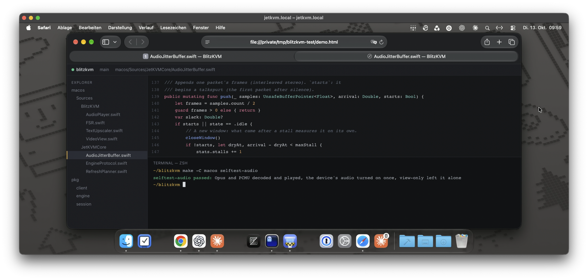

# BlitzKVM

A native macOS client for [JetKVM](https://jetkvm.com) devices, built for daily remote work: several devices, reached over a LAN or any VPN (Tailscale is the reference), in long, latency-sensitive sessions. It comes with an optional firmware build for the JetKVM that makes text sharper, input faster and adds stereo audio.



**Contents:** [Highlights](#highlights) · [Requirements](#requirements) · [Install](#install) · [Using the app](#using-the-app) · [BlitzKVM firmware](#blitzkvm-firmware) · [Privacy and security](#privacy-and-security) · [Benchmarks](BENCHMARKS.md) · [Development](#development) · [License](#license)

BlitzKVM started from [lkarlslund/jetkvm-desktop](https://github.com/lkarlslund/jetkvm-desktop) (MIT); the macOS app, the engine's session and video work and the firmware changes came later. It is not affiliated with or endorsed by JetKVM.

## Highlights

- **Low latency.** A key press shows on screen 78 ms after you press it at 2400×1012, 60 Hz (about 45 ms of that is the remote computer drawing it), and 47 ms at 1280×720, 120 Hz. Pointer moves: 53 ms.
- **Sharp text.** Once the screen stops changing, the picture refreshes to near-lossless (text at 60 dB against 33 dB on JetKVM's own firmware), color is rebuilt from full-resolution brightness, and a small neural network trained on macOS text enlarges it for Retina screens.
- **Match Window.** The remote computer takes your window's size, up to 120 Hz for small windows and 3008×1268 for a 40" display.
- **Sound.** The remote computer's audio plays here: Opus stereo with the BlitzKVM firmware, and nothing on the wire while it is silent.
- **Slow links.** Automatic quality follows each frame's queueing delay and keeps the encoder's peaks below what the link delivers, so cellular and relayed Tailscale links stay usable. Lower levels cost sharpness, never frame rate. A JetKVM that runs Tailscale itself is reached directly where the routers allow it, past its own Tailscale (BlitzKVM firmware).
- **Follows you.** An open window moves between a device's LAN address and its tailnet name as you leave home or come back, without reconnecting by hand.
- **Everything a KVM needs.** Keyboard capture including system shortcuts, an absolute pointer that goes where you hover, paste as keystrokes, virtual media, serial console, ATX/DC power, Wake Computer, several devices as tabs.
- **Clipboard sync with a Mac.** Copy on one Mac, paste on the other: text, rich text and images, over the JetKVM's USB cable, with nothing installed on the remote Mac but a key (BlitzKVM firmware).
- **JetKVM Setup.** Firmware, password and Tailscale on the device, each with one button.
- **Updates itself.** From signed, notarized GitHub releases, after asking or on its own when you quit.

Numbers and methods: [BENCHMARKS.md](BENCHMARKS.md).

## Requirements

- A Mac with Apple silicon on macOS 14 or later (the app is arm64-only).
- A JetKVM on firmware 0.5.9, JetKVM's own build or the [BlitzKVM firmware](#blitzkvm-firmware). Tested with the JetKVM v2.

## Install

- **Download:** get `BlitzKVM.zip` from the [latest release](https://github.com/wottpal/blitzkvm/releases/latest), unzip it and move `BlitzKVM.app` to `/Applications`. From then on BlitzKVM updates itself.
- **Build from source:** see [Development](#development); `make -C macos install` builds the app and copies it to `/Applications`.

On first launch a welcome screen asks for **Local Network** access (required: JetKVMs answer on the local network) and **Accessibility** (recommended: ⌘Tab, ⌘Space and other system shortcuts then reach the remote computer). BlitzKVM › Settings… (⌘,), also the gear in the Devices window, shows both later under Permissions, next to General (updates) and Shortcuts.

**Updates:** BlitzKVM checks its GitHub releases once a day and offers each new version with its release notes; BlitzKVM › Check for Updates… checks now. In Settings › General you can turn the daily check off, or have updates download in the background and install when you quit BlitzKVM. Every update is notarized by Apple and signed with BlitzKVM's update key, and the app checks that signature, and that the new app carries the same Developer ID, before it installs anything (Sparkle).

## Using the app

The Devices window (⌘N) holds the device library: a name, an ordered list of addresses (LAN IP, `.local` name, VPN name; `https://…` for TLS) and per-device preferences. Addresses are probed over HTTP in parallel and the earliest that answers wins; probing never opens a WebRTC session, because that would take over an existing one. Devices show as a gallery of screens that light up while the device answers (the same probe, every 30 s while the window is visible); the most recently used one starts selected, so Return connects it. Connecting closes the window; closing the last device window brings it back.

**Device › Device Settings** edits the current window's device (name, addresses, password, remote computer) and applies it at once. **JetKVM Setup** (Device › Set Up JetKVM, or the setup badge on a device in the Devices window) shows three things and fixes each with one button. The badge shows how far a device is (a dot per step, filled when done) as of the last check; every connection checks quietly, and a click on the badge connects and opens the sheet. Below them, optional: on BlitzKVM firmware that has the switch, **Browser Access** turns off the device's web interface for browsers; the app keeps connecting and can turn it back on. On BlitzKVM firmware with the USB link, **Clipboard Sync** sets up, turns on or off, and removes clipboard sync with the remote Mac ([below](#clipboard-sync)).
- **Firmware:** the app ships two builds, so nothing is downloaded: the BlitzKVM firmware (recommended) and JetKVM's own latest release, both pinned by SHA-256 in `macos/Support/Firmware.json`. The row shows which runs (by the installed binary's hash). Its button installs the BlitzKVM build; its menu reinstalls either, switches to JetKVM's own, or restarts the JetKVM. Installing uploads the build next to the running app, checks it, and restarts the JetKVM, which moves it into place as it does an update (about a minute). The previous build stays as `/userdata/jetkvm/jetkvm_app.backup`, and a boot guard (the BlitzKVM firmware's `scripts/fork/install_guard.sh`) puts it back by itself if the new one doesn't answer within a few minutes of the restart, or the JetKVM keeps restarting, so an install over Tailscale can't strand the JetKVM. JetKVM Setup takes the guard off once the new build has answered twice, 5 minutes apart, and the row says so if the guard had to go back. JetKVM's automatic updates replace a BlitzKVM build with their next release.
- **Password:** set the JetKVM's first password (kept in your keychain), so not everyone who can reach it controls the computer. Its menu changes the password or turns it off.
- **Tailscale:** Install downloads the current release for 32-bit ARM from pkgs.tailscale.com, checks it against its SHA-256, and installs it as `tailscale configure jetkvm` expects, so it starts at boot. The JetKVM doesn't restart. The kernel's `tun` module gives it a real `tailscale0` interface. Your browser opens to log in, and once the JetKVM is on the tailnet its name (e.g. `mac-mini-jetkvm.<tailnet>.ts.net`) is added to the device's addresses. Turn off key expiry for it in the admin console, or it drops off the tailnet when its key expires.

Installing uses SSH: the app turns on Developer Mode and adds its own key (`~/Library/Application Support/BlitzKVM/SSH/`) to the device's keys, keeping any others.

**Remote access:** list the LAN address first and the tailnet name second. At home the LAN address answers first; away, the tailnet name does. An open window follows you between the two, so closing the lid at home and opening it elsewhere needs no reconnect (and the other way round):
- **The session drops** (a new network, sleep): the window probes the addresses every 3 s, and 0.5 s after the network changes, and moves to the first that answers; when the address it has answers again, it reconnects at once instead of waiting out its retry.
- **Connected through a later address** (the tailnet name, back home): it checks the earlier ones every 15 s, and every 3 s for 10 s after the network changes, and moves to one that answers once your input pauses for 2 s (nothing held down, no paste, upload, setup step or display resize under way). The picture pauses briefly while it reconnects. A picture that already takes the LAN path (the direct path below) stays where it is.
- An address that answers while no session comes up through it for 20 s goes last until the network changes (at most 30 minutes), so a window never bounces between two addresses. The title bar shows the address in use.

Video takes the route of the address the app connected to, and the status bar names it: via LAN, via Tailscale, via Tailscale relay `<region>` (no direct path: Tailscale relays it, much slower), via VPN, or via internet. With Tailscale on the JetKVM itself, its single core encrypts every packet of the picture (WireGuard, about 1.1 ms of CPU each), so the JetKVM, not your connection, limits the picture to about 2–2.5 Mbit/s; automatic quality keeps below that ([BENCHMARKS.md](BENCHMARKS.md#over-tailscale-on-the-jetkvm)). The app then looks for a direct path past Tailscale: public STUN servers tell this Mac its internet address, and the BlitzKVM firmware (0.5.9-fork.9 or later) tells the JetKVM its own, so picture and input go straight through both routers where they allow it (via internet), or over the LAN when you are home (which works with JetKVM's own firmware too). Where no direct path works they stay on Tailscale: the window then connects 1.5 s later, and doesn't try again on that network for 30 minutes. Settings › Connection turns this off ([BENCHMARKS.md](BENCHMARKS.md#a-direct-path-past-tailscale-on-the-jetkvm)).

**Input:** a click on the remote screen or ⌘ pressed twice captures the keyboard, system shortcuts included; ⌃⌘ releases it. Focusing the window alone never captures, so ⌘Tab passes through. Typing into the window before that briefly dims the picture inside an accent frame and says how to take control. Hovering over the picture puts the remote pointer exactly there (USB absolute pointer), also while another app is active (off a LAN, moves go out at most 60 times a second, the device's frame rate: each costs its single core a packet); your own pointer is hidden over the picture, so only the remote one shows (View › Local Pointer can also show yours as a dot or an arrow: it moves without the stream's delay and hides once it rests). A Mac maps that absolute pointer onto its **main display only**: on a Mac target the JetKVM's display must be the main display (System Settings › Displays), or the pointer never shows on it. Also: Mac/PC modifier profiles (a PC one swaps ⌘ and Ctrl; a PC-key-positions one sends ⌥ as Windows and ⌘ as Alt), paste as keystrokes (⌥⌘V), Wake Computer (a one-pixel pointer nudge and a Shift tap for a sleeping display, and JetKVM's wake-only USB signal for a suspended computer: from firmware 0.5.9 on, ordinary input no longer wakes one), power control (ATX/DC), Restart JetKVM (the computer keeps running and the window reconnects by itself), virtual media (⇧⌘M), serial console (⇧⌘L), extension port switching and several devices as tabs.

**Shortcuts for This Mac** (Settings › Shortcuts): key combinations that stay on this Mac while a window has the keyboard, so another app's hotkey still works, a dictation app's ⌥ fn for example. Record a key with modifiers (or a function key), or two or more modifiers alone (or fn). Modifiers already pressed on the remote are lifted there; modifiers alone keep every modifier change on this Mac until all are up. With **Keep control** ticked, the window takes the keyboard back when it's in front again within 10 minutes of the shortcut: a dictation app's window may take focus while you speak, and its text then still reaches the remote. **Send what apps paste to the remote computer** (on by default): when another app pastes into the window with ⌘V (dictation does), this Mac's clipboard is pasted on the remote computer, not the remote's own. With clipboard sync running, the clip goes to the remote Mac's clipboard first and ⌘V follows once it arrived, so the text comes through exactly; otherwise it's typed as keystrokes. Edit › Paste in a device window does the same (Superwhisper, for one, pastes through it), what such apps mark as transient goes along, and keys pressed meanwhile (a Return after the text) follow the paste. A ⌘V you type still pastes the remote's clipboard.

### View modes

View menu ⌘1–⌘5, or the menu in the status bar, saved per device:

| Mode | Shows the remote screen | Notes |
|---|---|---|
| Actual Size (default) | One remote pixel per point: the size a monitor of that resolution would show it | 2× on Retina, enlarged by the text upscaler (below). The remote resolution stays as it is; the window sizes itself to it, and a smaller window pans with the pointer. |
| Scale to Fit | As large as the window allows | The text upscaler when enlarging up to 3×, FSR beyond; a widened Catmull-Rom when shrinking |
| Pixel for Pixel | One remote pixel per physical pixel | Tiny on Retina; for pixel inspection |
| Largest Whole Multiple | The largest whole multiple that fits | Always exact (nearest-neighbor) pixels |
| Match Window (opt-in) | The remote display takes the window's size, one remote pixel per point | Resize the window (or go full screen) and the target switches its resolution to match within a few seconds. Only for targets where the JetKVM is the only display; details below. |

**Match Window** (opt-in, explained once when chosen) changes the JetKVM's EDID (the display description the target reads over HDMI). The app keeps the device's identity, name and audio, and replaces its modes with a single mode of the window's size. The target re-detects the display, and the picture pauses for 2–5 s. The device saves the EDID, so the app keeps the one it replaced and puts it back when Match Window is turned off, the window closes or the app quits (waiting up to 3 s; a Match Window that was on before EDIDs were kept goes back to JetKVM Default). After a crash or force quit the target keeps the last resolution until the next session ends; JetKVM web UI › Settings › Video › EDID (JetKVM Default) also restores the default.
- **Sizes and rates:** 640×400 up to 3840×2160. The HDMI bridge's 165 MHz pixel clock sets the trade between size and rate, and it locks up to 120 Hz: 2448×1024 at 60 Hz for a 21:9 window, 3008×1268 at 40 Hz (a 40" full screen at full resolution, with the BlitzKVM firmware's capture buffers; JetKVM's own firmware stops at 3.1 megapixels), 1664×700 at 120 Hz. Smaller pictures at higher rates are faster: capture and encoding both scale with the pixel count.
- **View › Match Window Refresh:** Automatic takes the largest picture and then the highest rate that reaches it (a small window gets 90 or 120 Hz); each rate (120, 90, 75, 60, 50, 40, 30, 25, 24 Hz) is listed with the size the window gets at it. Larger windows than the limits get the largest mode of their shape, scaled to fill.
- **View › Match Window Scale:** 100% is one remote pixel per window point, 200% doubles everything (half the resolution), 50% halves it (twice the resolution, up to the limits). Saved per device.
- **Snapping:** widths are multiples of 16 and heights multiples of 4, so a window can be up to 15 × 3 points larger than the remote. In a window the app snaps the window to the remote; in full screen the gap stays as a thin border. While the target switches modes the app keeps showing the last picture.
- View-only sessions never change the EDID. The limits are measured on the hardware (`RemoteDisplay.swift`); an odd height hangs the device.
- **On a Mac with another monitor, do not use it:** macOS treats every new size as a new display with the default arrangement. The JetKVM display is then no longer the main display, so it shows an empty desktop and the absolute pointer cannot reach it.

**Full screen:** the menu bar, and with it the window's title bar and buttons, slides in when the pointer rests at the top edge, so you can leave full screen with the mouse. The Dock stays hidden because the bottom edge belongs to the remote.

### Picture

- **Enlarging up to 3×** (Actual Size on Retina, Scale to Fit, full screen): a small neural network trained on macOS text (`TextUpscaler.swift`) predicts a 3×3 grid of sub-pixel detail per remote pixel, which the compose pass resamples to any scale. A frame that changes much of the picture is drawn with FSR first and sharpened a tenth of a second later. A GPU too slow for it falls back to FSR.
- **Enlarging beyond 3×:** AMD FSR 1 (EASU edge-adaptive upscaling plus RCAS sharpening, `FSR.swift`).
- **Chroma:** the JetKVM sends color at half resolution. The app rebuilds it from the full-resolution luma, since within a few pixels desktop content mixes two colors.
- **Luma:** the HDMI bridge truncates luma; the app adds back half a code value.
- **Colors:** the bridge outputs BT.601 YCbCr while firmware 0.5.9 tags HD streams BT.709, so the app always decodes BT.601 (`VideoView.colorParams`; `BLITZKVM_COLOR_MATRIX=709` restores the declared matrix).
- **Output:** the picture is computed in floating point and drawn to a 10-bit layer.
- **Presenting:** a frame goes to the window server as soon as the GPU is done (no wait for our own vsync). After a pause macOS shows the first frame late or drops it, so for a second after each key or pointer move the window keeps presenting, and the remote's answer finds it awake (a pointer move shows about 15 ms sooner).

View › Exact Pixels at Whole-Number Scales switches to nearest-neighbor where the scale is a whole number. View › Scaling Filter swaps the enlargement filter for experiments (Automatic stays the default): FSR 1 with light, strong or no sharpening, Lanczos‑3, Catmull‑Rom, sharp bilinear, bilinear or nearest neighbor. View › Show Status Bar (⌘/) hides the status line in every window.

When the picture stalls for more than about half a second (connecting, a display resize, a stream that paused, no HDMI signal), a large overlay says why and what happens next. With no HDMI signal it offers Wake Computer, the only part of the overlay that takes a click. The last picture stays underneath, dimmed. Keyboard and pointer keep working.

### Stream quality

View › Stream Quality is **Automatic** by default: the engine walks a quality ladder (`pkg/session/autoquality.go`) from what the video's own packets say about the link (`pkg/video/link.go`). When frames start to queue (their delay past the capture timestamp grows), it steps down within 100–200 ms, straight to the level the link's measured delivery rate carries. It steps up one level at a time, after 20 s without congestion, and only once that rate has been measured carrying the next level; an idle screen measures nothing. Off a LAN the encoder's peak bitrate also follows that rate (0.9× it, 0.55× with Tailscale on the JetKVM, whose CPU saturates first), so scrolling stays below what the link delivers at any level; with the BlitzKVM firmware the frames are paced to that peak too, so a keyframe or a burst of large frames thins out instead of queueing in front of the next keystroke's echo. Every level encodes up to 60 fps: the levels differ in sharpness and bitrate, and changing level costs no keyframe. On a LAN it stays at maximum unless a queue builds, and with the BlitzKVM firmware maximum encodes every captured frame (90 or 120 fps in Match Window's faster modes, up to the encoder's 1080p60 pixel rate). A LAN is a round trip under 8 ms, or, to a device in the Mac's own subnet over Wi-Fi or Ethernet, a lowest round trip of the last minute under 30 ms: home Wi-Fi swings between 5 and 35 ms and counts. While Automatic is on, a dot in the menu marks the level it runs at. Manual presets set the device's quality factor (a JetKVM setting shared by all its clients). The encoder uses VBR, so higher factors only cost bandwidth while the screen changes.

With the BlitzKVM firmware a still screen refreshes to near-lossless: half a second after the screen stops changing, the device sends one keyframe at a very low QP, and the empty frames that follow keep it (a still screen costs 0.07 Mbit/s). Where the firmware leaves this to the client (`getFirmwareFeatures` lists `refreshRegions`), **the app decides when to refresh** (`RefreshPlanner.swift`), in windows that send input:
- **After a typing pause** (picture still for 250 ms, no input for 400 ms) only the regions that changed are re-encoded: up to six rectangles on 16-pixel blocks, at the level's P-frame QP floor, without a keyframe.
- **After a long pause** (no input for 3 s, picture still for 1 s) the whole frame gets the near-lossless keyframe, over the LAN and links as fast as one.
- **Slower links** get region refreshes only. A blinking caret or a ticking clock asks for nothing. View-only windows, the lowest quality level and other firmware keep the device's own refresh.

### Clipboard sync

With the BlitzKVM firmware (0.5.9-fork.8 or later) and a Mac on the other end, JetKVM Setup › Clipboard Sync › Set Up… syncs the two clipboards both ways: what you copy on one Mac is on the other's clipboard a moment later.
- **What it needs on the remote Mac:** Remote Login on (System Settings › General › Sharing), and nothing else. The remote Mac must be unlocked during setup, which takes about a minute; on a locked Mac the keystrokes would go to the password field.
- **Setup:** the JetKVM adds a USB network link to the remote Mac (its keyboard, mouse and virtual media reconnect once; a MacBook may first ask whether to allow the changed accessory). The app then opens Terminal there through ⌘Space (Spotlight, or a launcher in its place), types one command and closes that window again. The command adds this Mac's key to `~/.ssh/authorized_keys`, usable only from the JetKVM's end of the link and without a terminal or forwarding, and tells the JetKVM the account's name.
- **Keyboard layouts:** the JetKVM's keyboard layouts follow Windows, and on a Mac many characters sit on other keys. Setup therefore types the way a Mac with the input source of the JetKVM's layout does, from the layouts macOS ships (`make maclayouts`; `pkg/input/maclayouts_gen.go`): Czech, Danish, Swiss German, German, British, U.S., Spanish – ISO, Swiss French, French, Italian, Norwegian, Belgian, Polish – Pro, Portuguese, Slovenian and Swedish – Pro. The JetKVM's keyboard layout and the remote Mac's input source must match. Hungarian (its 0 is on a key macOS swaps on some keyboards), Japanese and Russian aren't supported yet: switch both to one of the others for the setup.
- **While it syncs:** the app logs in to the remote Mac's own SSH server through the JetKVM (end to end: the JetKVM never sees the key or the clipboard) and runs a small script there with `osascript`, sent with every session, that watches the clipboard. It ends with the session (a few minutes later if the USB cable is pulled mid-session). Synced: plain and rich text, HTML, links, and PNG or TIFF images, up to 8 MB per copy (images are left out first). Files aren't, and neither is anything a password manager marks as private. What was on either clipboard before syncing started stays where it is.
- **Turn Off** stops syncing and keeps the key on the remote Mac; **Remove…** takes the key off the remote Mac and turns the USB link off.
- On macOS 15.4 and later, macOS may ask whether BlitzKVM may read the clipboard. Allow it, or set BlitzKVM to Always Allow in System Settings › Privacy & Security › Paste from Other Apps; the setup row says so when macOS asks or refuses.

### Audio

View › Play Audio (on by default, for all windows; turned off it mutes at once, turned on it reconnects windows that connected without it): the remote computer's sound plays on this Mac.
- The JetKVM is a USB sound output of the computer it is attached to: choose it there as the output (a Mac lists it as "Playback Inactive", from JetKVM, in System Settings › Sound › Output). macOS remembers the choice; another remote desktop app may switch it to its own device.
- The JetKVM sends sound only while the computer plays some, so silence costs nothing: no packets, and this Mac's audio output starts with the first sound and stops 3 s after the last.
- The BlitzKVM firmware sends Opus (48 kHz stereo, about 128 kbit/s while sound plays); JetKVM's own firmware sends G.711 (8 kHz mono, telephone quality).
- JetKVM firmware keeps the device's audio off until a client turns it on: a window that controls the computer turns it on once (the device keeps the setting) and reconnects for it, which delays the picture by about a second, once. View-only windows play the sound where it is on but never turn it on.
- Each sound starts after the delay its packets needed over the last 20 s, so jitter and stalls raise the delay until they stop (`AudioJitterBuffer.swift`). The status bar names the codec while sound plays. Audio has its own queue in the helper and its own queue and thread in the app, apart from video and input.

## BlitzKVM firmware

The BlitzKVM firmware is JetKVM's open-source firmware ([jetkvm/kvm](https://github.com/jetkvm/kvm), GPL-2.0) with changes for desktop use, maintained in [wottpal/kvm](https://github.com/wottpal/kvm). Its [`FORK.md`](https://github.com/wottpal/kvm/blob/dev/FORK.md) lists every change, why it was made and its measurements. The app works with JetKVM's own firmware; the BlitzKVM build adds:

- Encoder settings for desktop content and near-lossless refreshes of still screens (text 60 dB instead of 33 dB).
- Keyframes on demand and a 60 s keyframe interval (a still screen costs 0.07 instead of 1.4 Mbit/s).
- Encoding that overlaps the capture (12 ms less per frame) and client-driven region refreshes after typing.
- Capture buffers for Match Window modes up to 4.19 megapixels, and no HDMI re-plug when its app restarts.
- Opus stereo audio that sends nothing while the computer is silent.
- Wheel steps over HID-RPC and a 1 s cap on the input channel's retransmission timeout.
- Frame pacing: large frames thin out to the link's rate instead of queueing in front of the next keystroke's echo, and quality changes cost no keyframe.
- STUN servers for the app's own sessions, so it can reach the JetKVM past the Tailscale it runs itself.
- Hardening: other websites can't reach the device through your browser (cross-site requests, DNS rebinding), malformed input can't crash it, and secrets stay out of its logs.
- A switch, in JetKVM Setup, that turns off the web interface for browsers while this app keeps connecting.
- An opt-in USB network link to the computer, for clipboard sync. The device runs its own network stack there, so none of its services (web interface, SSH) is reachable from the computer over the cable.

Install it with JetKVM Setup (one button; the previous build stays on the device as a backup), and switch back to JetKVM's own release from the same menu. JetKVM's automatic updates replace it with their next release. Installing any firmware other than JetKVM's own is at your own risk.

## Privacy and security

- **No telemetry.** The app talks to your JetKVMs, to GitHub once a day to look for updates (Settings turns that off), to pkgs.tailscale.com only when you install Tailscale from JetKVM Setup, and to public STUN servers for the direct path (below). The update check sends nothing but the request for the latest release's appcast.
- **Direct path** (on by default; Settings › Connection turns it off): when the app reaches a JetKVM over the Tailscale the JetKVM runs itself, this Mac, and the JetKVM with the BlitzKVM firmware, ask public STUN servers (Cloudflare, Google) for their internet addresses. Those servers learn the two addresses and nothing else; the session never passes them. It is protected like every WebRTC session: ICE credentials and DTLS-SRTP, whose certificate fingerprints travel over Tailscale. `BLITZKVM_STUN_SERVERS` names other STUN servers.
- **Identity before input.** A session accepts input only after the device's ID matches the one pinned on first connect.
- **HTTPS trust on first use.** The device's certificate authority is pinned; a change stops the session before any password is sent, and the app asks whether to trust the new one.
- **Passwords** live in the login keychain.
- **JetKVM Setup** turns on Developer Mode on the device and adds the app's own SSH key (`~/Library/Application Support/BlitzKVM/SSH/`) to it, keeping any others.
- **Browser access off** (optional, BlitzKVM firmware with the switch): the device refuses every web browser, so other websites can't reach it through yours; only apps like this one connect. JetKVM's own firmware ignores the setting.
- **Clipboard sync** (optional, BlitzKVM firmware with the USB link): the remote Mac accepts the app's clipboard key (`~/Library/Application Support/BlitzKVM/SSH/clipboard_ed25519`) only from the JetKVM's end of the USB link, and the app pins the remote Mac's SSH host key at setup. The session is SSH end to end, so the JetKVM relays it without seeing the clipboard. Items a password manager marks as private aren't synced.

Report security issues privately as described in [SECURITY.md](SECURITY.md).

## Development

The rest of this README is for contributors, human or agent. [`AGENTS.md`](AGENTS.md) links here.

### Scope

| Path | What it is |
|---|---|
| `macos/` | SwiftPM package and Makefile for the app. `Sources/JetKVMCore` holds testable logic (wire protocol, device library and address roaming, key mapping, geometry, certificate pinning, serial text filter, audio jitter buffer); `Sources/BlitzKVM` holds the AppKit/SwiftUI app; `Tests/` holds the unit tests. |
| `cmd/blitzkvm-engine` | The helper the app launches per device. It speaks `pkg/engineipc` over stdin/stdout and logs to stderr. |
| `pkg/client` | One WebRTC connection to a device: auth, signaling, RPC, HID-RPC, video, audio, serial. |
| `pkg/session` | Connection lifecycle (reconnect, backoff, identity and TLS pinning, quality, events) on top of `pkg/client`. |
| `pkg/engine`, `pkg/engineipc` | The helper's command loop and the app↔helper framing. |
| `pkg/video` | RTP access-unit assembler and link measurements (`pkg/video/openh264`: software decoder for the emulator and tests only). |
| `pkg/protocol/{auth,signaling,jsonrpc,hidrpc,tlspin}` | Wire protocols and HTTPS certificate pinning. |
| `pkg/input` | Keyboard mapping and layout-aware paste; `layouts_gen.go` is generated. |
| `pkg/netimpair` | The slow-link model behind `BLITZKVM_IMPAIR`. |
| `pkg/emulator`, `test/emulator-serve` | A firmware-faithful fake JetKVM (behaves like firmware 0.5.9) and its CLI, so everything can be tested without hardware. |
| `third_party/openh264-go` | Vendored OpenH264 bindings with static libraries (cgo), wired in by a `replace` in `go.mod`; used by the emulator and tests, never by the app. |
| `tools/` | Latency probe, quality bench and the text upscaler's training (each with a README). |
| `plans/` | Engineering plan: roadmap, decisions, measurements. |

### Setup

Requirements, as used on the development Mac:

- macOS 14 or later on Apple silicon.
- Xcode with the macOS 26 SDK or later in `/Applications/Xcode.app` (developed with 27.0). The macOS Makefile points `DEVELOPER_DIR` at it; the Command Line Tools alone cannot build the app's SwiftUI macros or its Icon Composer icon.
- Go: `go.mod` pins `toolchain go1.27.2`. Any recent `go` downloads it automatically.
- A C/C++ compiler for cgo (from Xcode), needed by the OpenH264 bindings the emulator uses.
- Optional: `ffmpeg` (H.265 and High-profile replay tests skip without it), `actionlint`, and a "Developer ID Application" certificate in the login keychain for stable signing.

### Commands

Run root targets from the repository root and macOS targets with `make -C macos <target>`, also from the root.

| Command | Does |
|---|---|
| `make build` | `go build ./...` |
| `make test` | Go tests (`-p 1`) plus the vendored OpenH264 module's tests |
| `make test-race` | Go tests with the race detector |
| `make test-timing` | Timing-sensitive tests that skip themselves under `-race` (NACK loss repair, also at long round trips) |
| `make vet` / `make vulncheck` | `go vet`; govulncheck |
| `make generate` | Regenerates the enumer files (`*_enums.go`) |
| `make generate-check` | Regenerates, then fails if `git diff` is not empty, so it also fails on any uncommitted change |
| `make check` | What CI runs (`.github/workflows/ci.yml`): vet, generate-check, race tests, timing tests, govulncheck, OpenH264 tests, Swift tests |
| `make layouts UPSTREAM=../kvm` | Regenerates `pkg/input/layouts_gen.go` from a `jetkvm/kvm` checkout |
| `make emulator` | Runs the emulator on `http://127.0.0.1:8080` (no password) |
| `make -C macos app` | Builds and signs `macos/build/BlitzKVM.app`; a signed build is also copied to `~/Downloads` |
| `make -C macos firmware` | Bundles the firmware builds JetKVM Setup installs, pinned by SHA-256 in `macos/Support/Firmware.json`: the BlitzKVM build from `FORK_BINARY` (default: `bin/jetkvm_app` of a [wottpal/kvm](https://github.com/wottpal/kvm) clone next to this repository), and JetKVM's own release from its GitHub release (downloaded once into `macos/build/firmware-cache`). `make app` runs it; a build whose binary is missing is left out |
| `make -C macos licenses` | Assembles `macos/build/licenses/Licenses.txt` (BlitzKVM › Licenses…): BlitzKVM's license, FSR's, the Go standard library's and every Go module the helper links (from the module cache), and the bundled firmware's GPL-2.0 with its source links, libopus and LVGL. `make app` runs it |
| `make -C macos test` | Swift unit tests |
| `make -C macos selftest` | End to end: the app against the emulator (video, injected input, helper crash recovery) |
| `make -C macos selftest-extras` | End to end over http and https: virtual media (upload, mount, eject, delete), serial console, address probing with certificate pins |
| `make -C macos selftest-stalls` | End to end with the BlitzKVM firmware's keyframe policy: the picture may stand still no longer than a link stall, and resumes once a hidden window is shown |
| `make -C macos selftest-refresh` | End to end with firmware D13's still refresh: region refreshes after typing pauses, none while typing, a full refresh after a long pause; a view-only window leaves refreshes to the device |
| `make -C macos selftest-audio` | End to end with the emulator's tone, played at zero volume: the BlitzKVM firmware's Opus in a window that turns the device's audio on (once, then reconnects), JetKVM firmware's PCMU in a view-only window, and nothing from a device whose audio is off; view-only never changes the setting |
| `make -C macos selftest-roaming` | End to end with one device at two addresses (two emulators, one device ID): the window starts at the preferred address while it is down, moves to the other, moves back once the preferred one answers, and away again once it stops (about 45 s) |
| `make -C macos selftest-update` | The updater end to end, maintainers only (it signs with the update key from the keychain): an older copy installs a newer one from a local signed appcast when it quits; an archive changed after signing is refused |
| `make -C macos run DEVICE=jetkvm.local` | Builds and opens the app connected to a device |
| `make -C macos install` | Copies the app to `/Applications` |
| `make -C macos notarize` | Notarizes with the Xcode account and staples; leaves `macos/build/BlitzKVM.zip` (see [Signing and distribution](#signing-and-distribution)) |
| `make -C macos release NOTES=notes.md` | Notarizes HEAD and publishes it as the latest GitHub release with a signed appcast, which installed apps pick up (see [Releases and updates](#releases-and-updates)) |

Focused checks, by what you changed:

- When you edit `pkg/emulator`, `pkg/client`, `pkg/session` or `pkg/engine`, run `go test -race -count=1 ./pkg/<package>`. If you touched video, NACK or netem code, also run `make test-timing`.
- When you edit `macos/Sources/JetKVMCore`, run `make -C macos test`.
- When you edit `macos/Sources/BlitzKVM`, `pkg/engineipc` or engine commands, run `make -C macos selftest` and `make -C macos selftest-extras`. If you touched video, the decoder or keyframe handling, also run `make -C macos selftest-stalls`; if you touched still refreshes (`RefreshPlanner`, `StillRefresh`, input or frame handling), `make -C macos selftest-refresh`; if you touched audio (`AudioPlayer`, `AudioJitterBuffer`, `pkg/client/audio.go`, `pkg/session/audio.go`), `make -C macos selftest-audio`; if you touched address roaming (`AddressRoaming`, the window's `roam`, address probing), `make -C macos selftest-roaming`.
- When you touch updates (`Updater.swift`, the `SU…` keys in `Info.plist.in`, Sparkle's version, `scripts/release.sh`), run `make -C macos selftest-update`.
- When you add or update a Go module the helper links, or bump a bundled firmware build, run `make -C macos licenses` and check that it succeeds (it fails on a module without a license file).
- Before you push, run `make check` (or its steps individually while the tree is dirty, since `generate-check` needs a clean tree).

A passing self-test prints a JSON report and ends with `selftest passed: …`. Any other ending is a failure.

### Architecture

```
BlitzKVM.app (Swift)                          one helper per device
  DeviceWindowController ── VideoDecoder (VideoToolbox) ── VideoView (Metal)
  AudioPlayer (AVAudioConverter, AudioJitterBuffer, AVAudioEngine)
  InputController, VirtualMediaWindow, SerialConsoleWindow, Settings, Updater (Sparkle)
        │  length-prefixed frames over stdin/stdout (pkg/engineipc ⇄ EngineProtocol.swift)
        ▼
  blitzkvm-engine (Go): engine → session.Controller → client.Client
        │  HTTPS/HTTP login, WebSocket signaling, WebRTC (H.264/H.265 and Opus/PCMU RTP; data channels rpc, hidrpc, serial)
        ▼
  JetKVM device (firmware 0.5.9)        or        pkg/emulator for tests
```

Invariants that changes must keep:

- **Input only after identity is confirmed.** The session is `connected`, the only phase that accepts input, only after the device ID matches the pinned one. That check happens before login when the device answers `GET /device` without a password, otherwise over RPC right after login. A device ID learned on first connect pins later reconnects.
- **HTTPS trust on first use.** `pkg/protocol/tlspin` pins the device CA that the presented chain is signed up to (the firmware issues a leaf per hostname, signed by a device CA it sends along). Publicly trusted devices are pinned to public trust (`webpki`). A change stops the session before any password is sent; the app offers "Trust New Certificate". The Swift probe (`CertificatePin.swift`) mirrors these rules.
- **Video:** the engine assembles RTP into access units (`pkg/video`) and forwards them; when the app falls behind, it drops to the next keyframe rather than queueing. The app offers H.265 (H.264 stays in the offer as a fallback); JetKVM picks H.265 whenever the offer contains it. `--h264` exists only for the self-tests, because the emulator's live test pattern is H.264. The app renders on its own queue as frames arrive: NV12 → RGB at the source size (chroma upsampled at the stream's siting), then resampled to the drawable (`VideoView.swift`); the layer is tagged sRGB because the captured desktop is sRGB-encoded.
- **Audio stays off the video path:** its own queue and writer in the helper (overflow drops audio, never video), its own decode queue and output thread in the app.
- **One owner per session:** `pkg/session` runs the connect/reconnect loop on one goroutine; results of slow RPCs are applied only if their client is still current.

### Rules for contributors and agents

Mandatory:

1. **Never send keyboard or mouse input to, change settings on, or reboot a real JetKVM whose target is the machine you are working on.** Keystrokes would type into your own session. Use `--view-only` against it. Live Go tests run whenever `JETKVM_BASE_URL` is set and they send key presses; settings changes and reboots are additionally gated by `JETKVM_LIVE_ALLOW_SETTING_MUTATIONS=1` and `JETKVM_LIVE_ALLOW_DISRUPTIVE=1`. Do not set these for that device.
2. **Base claims about device behaviour on the firmware source** (`jetkvm/kvm`, branch `release/0.5.9`, and [wottpal/kvm](https://github.com/wottpal/kvm) for the BlitzKVM build), with file references. When the emulator and firmware disagree, fix the emulator to match the firmware; never shape the emulator around the client.
3. **Change the engine IPC on both sides at once:** `pkg/engineipc/engineipc.go` and `macos/Sources/JetKVMCore/EngineProtocol.swift`.
4. **Do not edit generated files by hand:** `*_enums.go` (run `make generate`) and `pkg/input/layouts_gen.go` (run `make layouts UPSTREAM=…`). `pkg/emulator/params.go` mirrors upstream `rpcHandlers` parameter lists for release 0.5.9; it was extracted with a one-off script that is not committed, so update it from upstream `jsonrpc.go` when targeting a new firmware.
5. **Regi** (AGPL-3.0, another JetKVM client) is learn-only: never read its source while implementing, and never copy from it.
6. **Security changes need an attack test.** When you change identity checks, TLS pinning or credential handling, add a test that plays the attacker (see `pkg/session/tls_test.go`, where an intercepting proxy must not receive the password) and confirm it fails without your fix.
7. **Never commit credentials:** no signing identities, private keys, passwords or API keys. Notarization uses the account signed into Xcode.
8. **Never commit details of your own setup:** no real device or computer addresses (LAN or Tailscale), tailnet names, device IDs, usernames, home-directory paths or personal email addresses, in code, tests, docs, plans or commit messages. Use placeholders: `192.168.1.40` for a device, `100.64.0.20` and `100.64.0.21` for tailnet addresses, `mac-mini-jetkvm.example.ts.net`, device ID `0123456789abcdef`. Commit with your GitHub noreply address.

Preferred:

- Give tests a negative control: break the code on purpose and check that the test fails.
- Use event-driven waits, and `ICELoopbackOnly: true` for emulator-backed tests. A Mac with several network interfaces makes ICE slow and flaky otherwise.
- Keep comments short and about why. Match the surrounding style (Go: gofmt; Swift: existing file conventions).

Ask the owner before you:

- act on real hardware beyond view-only use;
- push to `main` or to any remote other than the working branch;
- notarize or publish a build;
- delete images from a real device's storage;
- change the roadmap or a decision recorded in the plan.

CI (`.github/workflows/ci.yml`, macOS 26) runs `make check`'s steps and an unsigned app build on pull requests and on demand, and on pushes to `main` while the repository is public (macOS minutes are billed on private repositories). `webui-smoke.yml` runs JetKVM's own web UI against the emulator, on demand.

### Signing and distribution

`make -C macos app` signs with the first "Developer ID Application" identity in the login keychain (currently Scio Labs, team `79UD4HPFRD`), using the hardened runtime and a secure timestamp. Without such an identity it signs ad hoc; Accessibility and Local Network grants then reset on every rebuild. Override with `SIGN_IDENTITY="…"`. Set `COPY_TO=` (empty) to skip the `~/Downloads` copy.

`make -C macos notarize` notarizes with the Apple ID signed into Xcode (Settings → Accounts, team `79UD4HPFRD`); it needs no app-specific password or API key. `macos/scripts/notarize.sh` wraps the signed app in a minimal Xcode archive, uploads it with `xcodebuild -exportArchive`, and waits until Apple has processed it (usually a few minutes). It then fetches the stapled app with `xcodebuild -exportNotarizedApp` and leaves `macos/build/BlitzKVM.zip`, also copied to `~/Downloads`. Notarizing publishes the build to Apple, so only do it when the owner asks for a shareable build.

The app shows its licenses under BlitzKVM › Licenses…, assembled at build time (`make -C macos licenses`); the bundled firmware builds are GPL-2.0, and that window links their source.

### Releases and updates

The app updates itself with [Sparkle](https://sparkle-project.org) (`Updater.swift`) from `SUFeedURL`, the appcast of the latest GitHub release. Info.plist requires a signed feed and archive verification before extraction (`SURequireSignedFeed`, `SUVerifyUpdateBeforeExtraction`), and its `SUPublicEDKey` is the public half of the update key, whose private half is in the maintainer's login keychain (Sparkle's `generate_keys`, account `blitzkvm`). Releases are built, notarized and signed on that Mac; nothing in CI holds a key.

To release: set `CFBundleShortVersionString` in `macos/Support/Info.plist.in`, commit and push to `main`, write the release notes (Markdown, they appear in the update window), then run `make -C macos release NOTES=notes.md` from the repository root. `macos/scripts/release.sh` refuses a dirty tree, a HEAD that isn't `origin/main`, an app that isn't notarized or isn't of HEAD, an existing tag, and a keychain key that doesn't match `SUPublicEDKey`. It then signs the appcast (`generate_appcast`, release notes embedded) and creates release `v<version>` with `BlitzKVM.zip`, `appcast.xml` and `SHA256SUMS.txt`, marked latest. The build number is the commit count, so every release outranks the last.

Mandatory:
- **Back up the update key** (`macos/.build/artifacts/sparkle/Sparkle/bin/generate_keys --account blitzkvm -x <file>`, into a password manager, then delete the file). Without it, installed apps can't verify any later update and every user has to download the app again by hand.
- **Never commit the key** or put it in CI.

`make -C macos selftest-update` tests the whole path before a release: an older copy (another bundle identifier, so your own app's update settings stay untouched) runs a self-test with `BLITZKVM_UPDATE_FEED` pointing at a local appcast signed with the real key, and must have installed the newer copy once it quits; an archive changed after signing must not be installed. Self-tests check for updates only when `BLITZKVM_UPDATE_FEED` is set.

### Command-line options

Also used by the self-tests:

| Option | Meaning |
|---|---|
| `--device <address>` | Connect to an address instead of showing the device library. Self-tests also take a list (`a,b`, most preferred first): the window starts at the first and roams only between those |
| `--view-only` | Never send keyboard or mouse input |
| `--scale actualSize\|fit\|pixelExact\|integer\|matchWindow`, `--match-scale 1.5`, `--match-refresh 60\|auto`, `--scaling-filter lanczos`, `--local-pointer hidden\|dot\|arrow`, `--profile mac\|pc\|pcLayout`, `--window-size 1280x720`, `--full-screen` | View and input overrides |
| `--selftest <seconds>` and `--crash-engine-after`, `--inject-input`, `--exercise-extras`, `--snapshot <png>`, `--hide-after <seconds>`, `--max-freeze-ms <ms>`, `--set-quality-after 4:low,9:maximum`, `--toggle-status-bar-after <seconds>`, `--type-pauses`, `--expect-audio opus\|pcmu\|none` | Self-test mode (prints JSON, exits 0 on success). The window floats above other windows and never captures your own keyboard or pointer; only `--inject-input` and `--type-pauses` (typing bursts, then checks the still refreshes) send input. Self-tests play no audio, except with `--expect-audio`, which plays it at zero volume and fails unless it came in that codec (or none came). The window's number is logged (`selftest: window number N`) for `screencapture -l N` |
| `--setup check\|install-tailscale\|login\|restart\|install-firmware[=blitzkvm\|stock]\|password=<new password>\|change-password=<new password>\|remove-password\|browser-access=off\|on\|clipboard\|clipboard-on\|clipboard-off\|clipboard-remove\|clipboard-roundtrip\|snapshot=<png>`, `--setup-snapshot <png>`, `--wake` | With `--selftest`: opens JetKVM Setup, runs the actions (several, comma-separated, in turn), and reports the states (`setup`, `setupOK`); the snapshot renders the sheet (`snapshot=` between two actions). `clipboard-roundtrip` puts a token on this Mac's clipboard, types a command on the remote Mac that appends `-back` to its clipboard (its frontmost window must be a shell prompt) and waits for the result here (`clipboardRoundtrip`). `--wake` wakes the target once connected (no keystrokes) |
| `--latency-probe <samples>` | Measures input-to-photon latency against `tools/latency-probe/latency.html` on the target (prints JSON, exits). Like a self-test, its window floats, lets the pointer pass through, and leaves the library and update checks alone; it reads a saved device's password |
| `--quality auto\|minimal\|low\|balanced\|high\|maximum` | Automatic stream quality or a fixed level for this window |
| `--open settings\|licenses\|devices` | Opens Settings, Licenses or the Devices window (the welcome screen on first launch) at launch and logs its window number (`opened settings: window number N`) |

Environment: `JETKVM_DEVICE` and `JETKVM_PASSWORD` stand in for `--device` and a password. `BLITZKVM_UPDATE_FEED` replaces the update feed (`SUFeedURL`), to test a release before publishing it. `BLITZKVM_DEBUG_BLACKHOLE=period:duration` (seconds) makes the helper drop all session traffic for `duration` every `period`, to reproduce network hiccups. `BLITZKVM_IMPAIR` runs the session's traffic through a model of a slow link, both ways (`pkg/netimpair`): a profile (`lte`, `lte-congested`, `wifi-hotel`, `derp`), settings (`rate=4mbit,queue=1s,delay=40ms,jitter=5ms,loss=1%,burst=3,outage-every=20s,outage=200ms-800ms`, or `trace=<Mahimahi file>` for the rate), or a profile with overrides (`lte,loss=1%`). The helper logs what the link did when the session ends; `BLITZKVM_BENCH=60s go test -run TestSlowLinkBenchmark ./pkg/emulator` runs the session with automatic quality through each profile, against the emulator's model of the patched encoder (`BLITZKVM_BENCH_CONTENT=desktop|scroll|motion`). `BLITZKVM_ENGINE` points at a helper binary for development. `BLITZKVM_STUN_SERVERS` (space-separated `stun:` URLs) replaces the STUN servers of the direct path; an unreachable one (`stun:192.0.2.1:3478`) tests the fallback to Tailscale. `BLITZKVM_LOG_LEVEL` (error, warn, info, debug, trace) sets Go logging in the helper.

Where things live:

- Device library: `~/Library/Application Support/BlitzKVM/devices.json`.
- Passwords: the login keychain, service `xyz.scio.blitzkvm`, account = the device's ID (the entry's UUID until the ID is learned on first connect).
- SSH keys: `~/Library/Application Support/BlitzKVM/SSH/`, `id_ed25519` for JetKVM Setup on the device and `clipboard_ed25519` for clipboard sync with remote Macs.
- Logs: `~/Library/Logs/BlitzKVM/app.log` holds app messages and each helper's stderr.
- Update settings: the app's user defaults (`xyz.scio.blitzkvm`, Sparkle's `SU…` keys).

### Troubleshooting

- **`external macro implementation type 'SwiftUIMacros…' could not be found`:** you ran `swift build` with the Command Line Tools. Build through `make -C macos …`, which selects Xcode.
- **The picture stands still while the status bar still shows frames arriving:** something waited for a keyframe without asking for one. Every wait asks for a keyframe and normally ends within tens of milliseconds. `app.log` names each wait and how long it lasted (`video resumed at a keyframe after …`), and a watchdog logs `video watchdog: …` if frames arrive but none decode or reach the screen.
- **The picture stops after changing Stream Quality (or on its own, with Automatic):** BlitzKVM firmware before 2026-10-11 stopped encoding when a quality change switched between 60 and 30 fps, until the stream restarted. Install the current build.
- **Keyboard and pointer stop while the picture stays live, then work again:** the data channels (SCTP) were waiting out a retransmission timer after lost packets. The helper caps that timer at 1 s, and so does the BlitzKVM firmware (D09). `app.log` records `input data channels stalled` and `… recovered` with the duration.
- **`<` and `^` (or `` ` `` and `§`) come out swapped:** check the device's Remote Computer › Operating system. A Mac gets each key's key code unchanged, Windows and Linux its position. On a Mac remote that was told the JetKVM is an ISO keyboard (Keyboard Setup Assistant), they swap again: set it back to ANSI there with System Settings › Keyboard › Change Keyboard Type….
- **No sound:** the remote computer plays to another output. Choose the JetKVM there (a Mac lists it as "Playback Inactive" in System Settings › Sound › Output), and check View › Play Audio.
- **Emulator-backed tests time out in ICE:** set `ICELoopbackOnly: true` on both the emulator config and the client or session config.
- **`make generate-check` fails right after editing:** expected. It requires a clean tree; commit first or run the other `check` steps directly.
- **A device shows "not reachable" although it is up, and it uses https:** its certificate may have changed. Choose Try Anyway to see the certificate alert and decide whether to trust the new one.
- **Screenshots of app windows come out empty or fail:** the capturing process needs Screen Recording permission.
- **staticcheck:** not used. It cannot read go1.27 export data yet.

### Related docs

- [BENCHMARKS.md](BENCHMARKS.md): latency, picture quality, bandwidth, slow links and audio, with methods. Read it before claiming a performance change, and add your measurement there.
- [`plans/2026-10-10-engineering-plan.md`](plans/2026-10-10-engineering-plan.md): read before changing architecture, roadmap or a recorded decision. §4.2: verified firmware behaviour; §6: roadmap; §17: decision log; §19–§31: implementation status and measurement rounds.
- [`tools/latency-probe/README.md`](tools/latency-probe/README.md), [`tools/quality-bench/README.md`](tools/quality-bench/README.md), [`tools/text-upscaler/README.md`](tools/text-upscaler/README.md): the measurement tools and the upscaler's training.
- [`third_party/openh264-go/README.md`](third_party/openh264-go/README.md): the vendored OpenH264 bindings.
- Firmware: [wottpal/kvm](https://github.com/wottpal/kvm) (`FORK.md`: every difference from upstream, releases, procedures) and [`firmware/DEPLOY.md`](firmware/DEPLOY.md) (installing a build by hand). Upstream [jetkvm/kvm](https://github.com/jetkvm/kvm) develops on `dev`; releases are on `release/X.Y.Z` branches.

## License

MIT, see [`LICENSE`](LICENSE). The app also contains AMD FidelityFX Super Resolution 1 (MIT) and Go modules under their own licenses, and it bundles JetKVM firmware builds under the GPL-2.0 (source: [wottpal/kvm](https://github.com/wottpal/kvm), [jetkvm/kvm](https://github.com/jetkvm/kvm)). BlitzKVM › Licenses… lists them all with their full texts.

JetKVM is a trademark of its owner; BlitzKVM is an independent project and not affiliated with or endorsed by JetKVM.
